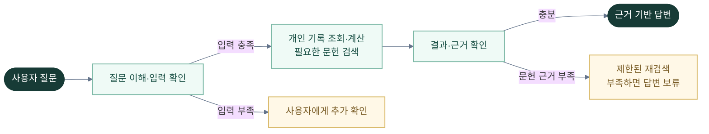

# Evidence-Grounded Agentic RAG

**개인 운동 기록의 변화와 운동과학 문헌의 근거를 함께 살펴보는 Agentic RAG 프로젝트입니다.**

공개된 장기 운동 기록을 개인 기록으로 가정하고, PostgreSQL에서 조회·계산한 결과와 문헌 검색 결과를 구분해 답변합니다. 입력이 불명확하면 추가 확인을 요청하고, 문헌 근거가 부족하면 제한된 재검색을 수행합니다. 끝까지 근거가 충분하지 않으면 답변을 보류합니다.

규칙 기반 실행 제어와 제한된 LLM 해석·판단을 결합했습니다. LLM은 질문 해석, 문헌 근거 평가, 검색 질의 재작성을 담당하며, Tool 실행·입력 검증·재시도 상한·종료 조건은 코드가 관리합니다.

**Python · FastAPI · LangGraph · Pydantic · PostgreSQL / pgvector · React / TypeScript**

[시스템 구조](docs/ARCHITECTURE.md) · [설치와 실행](docs/SETUP.md) · [평가와 한계](docs/EVALUATION.md) · [개발 이력](docs/HISTORY.md) · [프론트엔드](frontend/README.md)

## 실제 실행 화면

데드리프트의 처음 3세션과 최근 3세션 e1RM을 비교하고, 점진적 과부하와 관련된 문헌 근거를 함께 요청했습니다. 실제 웹 화면에서 질문을 전송하고, 답변과 실행 근거를 확인했습니다.


## 주요 기능

| 기능 | 동작 |
|---|---|
| 개인 기록 조회·계산 | 운동 기록을 조회하고 추정 1RM(e1RM), 세션별 요약, 주간 운동량·빈도, 운동 공백 등을 구현된 정의에 따라 계산합니다. |
| 운동과학 문헌 검색 | Dense와 BM25 검색 결과를 RRF로 결합하고, 질문에 필요한 문헌 근거를 확인합니다. |
| 기록과 문헌의 결합 | 개인 기록에서 관찰한 변화와 일반 연구 결과를 출처별로 구분해 설명합니다. |
| 추가 확인과 실행 재개 | 운동 후보가 여러 개이면 선택지를 제시하고, 검증된 선택을 기존 해석에 반영해 실행을 재개합니다. |
| 근거 부족 처리 | 부족한 문헌 근거를 대상으로 질의를 재작성하고 재검색합니다. 종료 조건에 도달하면 답변을 보류합니다. |
| 답변·근거 확인 화면 | React 화면에서 질문, 추가 확인, 답변, 사용 문헌과 실행 근거를 확인합니다. |

아래 구조와 사용 흐름은 **질문 해석·추가 확인 기능을 활성화한 구성**을 기준으로 설명합니다. 실행 시 필요한 환경 설정은 [설치 문서의 API 실행 절](docs/SETUP.md#api-실행)에 안내했습니다.

## 전체 동작 흐름



질문에 필요한 기록과 문헌만 조회합니다. 입력이 불명확하면 실행 전에 추가 확인하고, 문헌 근거가 부족하면 정해진 횟수 안에서 재검색합니다. 그래도 근거가 충분하지 않으면 답변을 보류합니다.

LangGraph는 이 흐름의 상태·분기·재시도·종료를 관리합니다. 각 구성요소의 역할과 세부 실행 경로는 [시스템 구조](docs/ARCHITECTURE.md)에 정리했습니다.

## 핵심 설계 원칙

- **계산과 해석을 구분합니다.** Metric은 코드로 계산합니다. e1RM 감소를 관찰했더라도 근육량 감소나 개인의 생리학적 원인으로 단정하지 않습니다.
- **불명확한 입력을 임의로 채우지 않습니다.** 실제 운동 목록과 입력 조건을 검증하고, 여러 운동 후보를 임의로 선택하거나 병합하지 않습니다.
- **LLM의 판단 범위를 제한합니다.** Pydantic 기반 구조화 출력과 검증을 사용합니다. 실행 순서, 후보 집합 검증, 재시도 상한은 LLM에 맡기지 않습니다.
- **검색 결과를 그대로 충분한 근거로 간주하지 않습니다.** 요구사항별 지원 여부와 근거 청크 ID를 검증하고, 부족한 부분에 대해서만 추가 검색을 시도합니다.
- **실행과 평가를 분리합니다.** Gold와 평가 정답은 실행 구성요소에 제공하지 않습니다. 동결한 데이터·평가셋·기존 기준선은 보존합니다.

## 실행과 데모

**공개 저장소에는 코드와 검토된 문서를 제공합니다.** 원본 운동 기록, 문헌 원문, 동결 검색 산출물과 모델은 포함하지 않습니다. 저장소를 복제하는 것만으로 전체 질의 실행이나 과거 연구 평가를 재현할 수는 없습니다.

| 실행 범위 | 준비 사항 |
|---|---|
| API 문서·서버 상태 확인 | Python 의존성을 설치합니다. DB·OpenAI 연결은 필요하지 않습니다. |
| 공개 테스트 | Python 의존성을 설치합니다. 실제 DB·OpenAI 호출 없이 검증합니다. |
| 실제 질문·답변 | 운동 기록 DB, 문헌·검색 산출물, 모델, 서버 환경변수를 준비합니다. |
| React 화면 | Node.js 의존성을 설치합니다. 실제 질의에는 준비된 백엔드가 필요합니다. |

### 백엔드

Python 3.13을 공개 CI 기준으로 사용합니다. Windows PowerShell에서 다음과 같이 설치합니다.

```powershell
python -m venv .venv
.\.venv\Scripts\Activate.ps1
python -m pip install -r requirements-api.txt
```

실제 질문을 실행하려면 [데이터·DB 준비](docs/SETUP.md#데이터와-db-준비)를 완료하고, [API 실행 환경 설정](docs/SETUP.md#api-실행)의 질문 해석·개인 Metric 추출 설정을 서버를 실행할 터미널에 적용합니다. **아래 서버 명령만으로 질문 해석·추가 확인 기능이 활성화되지는 않습니다.** 설정 후 서버를 실행합니다.

```powershell
python -m uvicorn src.api.app:app --host 127.0.0.1 --port 8000
```

Swagger UI는 [http://127.0.0.1:8000/docs](http://127.0.0.1:8000/docs)에서 확인합니다. 실제 질의에는 `PGPASSWORD`, `OPENAI_API_KEY` 등 서버 환경 설정이 필요합니다. [환경변수 안내 파일](.env.example)은 자동으로 로드되지 않습니다.

| API | 역할 |
|---|---|
| `GET /health` | 서버 생존 상태를 확인합니다. DB·LLM 준비 완료를 보장하지 않습니다. |
| `GET /version` | 공개 가능한 실행 설정을 반환합니다. |
| `POST /query` | 자연어 질문을 처리합니다. |
| `POST /query/clarify` | 운동 후보 선택을 검증하고 실행을 재개합니다. |

질문 입력 형식은 다음과 같습니다. 처리 결과는 준비된 기록과 문헌 근거에 따라 달라집니다.

```json
{
  "question": "내 데드리프트의 처음 3세션과 최근 3세션의 e1RM 중앙값을 비교해줘."
}
```

응답에서는 `final_status`, `answer_text`, 사용한 Tool과 문헌 청크 ID, 한계를 함께 확인합니다. 추가 확인 요청은 현재 공개 계약상 `abstain_ready`와 `response_metadata`로 표현합니다. HTTP 200만으로 답변 성공을 판단하지 않습니다.

### 프론트엔드

React·TypeScript 기반 화면에서 질문·답변, 추가 확인 입력, 문헌과 실행 근거를 확인합니다. Node.js 22.12 이상에서 별도 터미널을 열고 실행합니다.

```powershell
cd frontend
npm ci
npm run dev
```

[http://127.0.0.1:5173/](http://127.0.0.1:5173/)에서 화면을 확인합니다. 실제 API 연결과 저장된 서버 응답 재생을 지원합니다. 현재 저장소에 포함된 녹화 파일은 **실제 실행 결과가 아닌 형식 예시**이며 화면에서도 구분해 표시합니다. 실제 응답 녹화·재생 방법은 [프론트엔드 문서](frontend/README.md)에 정리했습니다.

## 검증과 한계

코드 동작 검증, 외부 서비스 연결 확인, 연구 성능 평가를 구분합니다.

| 검증 구분 | 확인하는 내용 |
|---|---|
| 단위·통합·공개 CI 테스트 | 통제된 응답과 합성 입력으로 입력 검증, 상태 전이, API 계약, 회귀 여부를 확인합니다. |
| 로컬 전체 테스트 | 공개 테스트에 더해 로컬 동결 산출물과 데이터 의존 검사를 수행합니다. |
| 실제 API 연결 확인 | 준비된 환경에서 DB·LLM·API 연결과 실행 결과를 확인합니다. 연구 성능과 구분합니다. |
| 연구 평가 | 고정된 조건에서 검색·근거 검증·최종 동작을 평가합니다. 버전과 평가 범위를 함께 기록합니다. |

공개 CI와 동일한 테스트는 저장소 루트에서 실행합니다.

```powershell
python -m pytest -m "not requires_local_artifacts" -q
```

로컬 연구 자료를 준비한 환경에서는 `python -m pytest -q`로 전체 테스트를 실행합니다. 프론트엔드는 `frontend` 디렉터리에서 `npm test`, `npm run lint`, `npm run build`로 검증합니다.

검색 방식, 질문 해석, Grader와 Recovery를 실험하고 채택·비채택 근거를 기록했습니다. 반복 분석한 평가셋의 결과를 독립적인 일반화 성능으로 표현하지 않으며, `answer_ready` 비율을 정확도로 사용하지 않습니다. 구체적인 결과와 조건은 [평가 문서](docs/EVALUATION.md), 변경 과정은 [개발 이력](docs/HISTORY.md)에서 확인합니다.

현재 주요 한계는 다음과 같습니다.

- 질문 해석과 문헌 근거 검증 과정에서 불필요한 추가 확인·답변 보류가 발생할 수 있습니다.
- 문헌에 필요한 근거가 없거나 검색에서 누락될 수 있으며, 재검색이 개선을 보장하지 않습니다.
- 개인 Metric 요청은 단일 Metric 중심으로 지원합니다. 임의의 복수 계산이나 운동 그룹 병합을 제공하지 않습니다.
- 최종 답변 전체의 과학적 정확성과 개인 조언의 적절성에 대한 독립적인 사람 평가는 수행하지 않았습니다.
- 인증, 요청 빈도 제한, 다중 사용자 데이터 격리를 제공하지 않는 로컬 데모입니다.

## 코드 구성

```text
src/api/             FastAPI 요청·응답과 실행 의존성을 관리합니다.
src/graph/           LangGraph 실행 흐름과 Tool 입력 인자를 관리합니다.
src/interpretation/  규칙 우선으로 질문을 해석하고 운동 후보를 검증합니다.
src/tools/           운동 기록 조회·Metric 계산·문헌 검색을 수행합니다.
src/metrics/         운동 지표의 계산 정의를 관리합니다.
src/retrieval/       Dense·BM25·RRF와 pgvector 기반 검색을 수행합니다.
src/grading/         문헌 근거의 충분성을 판정하고 평가 지표를 계산합니다.
src/recovery/        재검색 질의를 생성하고 기존 근거와 새 근거를 결합합니다.
src/answer/          근거 기반 답변과 답변 보류 응답을 생성합니다.
src/evaluation/      평가셋 검증과 검색·경로 선택·전체 실행 평가를 수행합니다.
src/agent/           구조화된 Tool 실행 계획을 정의하고 실행합니다.
src/routing/         규칙 기반으로 Tool 종류와 실행 순서를 결정합니다.
src/preprocessing/   운동 기록을 정규화하고 사용 가능한 기록을 검증합니다.
src/literature/      문헌을 수집·가공하고 출처 정보를 관리합니다.
src/database/        PostgreSQL 연결과 스키마 초기화·기록 적재를 담당합니다.
src/smoke/           전체 실행 흐름의 연결 확인을 지원합니다.
frontend/            React 기반 질문·답변·추가 확인·근거 화면을 제공합니다.
db/                  PostgreSQL 스키마와 pgvector 설정을 관리합니다.
config/              비밀값을 제외한 실행 설정과 프롬프트를 관리합니다.
scripts/             데이터 준비·평가·연결 확인용 실행 스크립트를 제공합니다.
tests/               실행 기능·평가·데이터 준비 과정을 검증합니다.
docs/                시스템 구조·평가·개발 이력·설치 방법을 안내합니다.
```

세부 책임과 현재 검색 설정은 [시스템 구조](docs/ARCHITECTURE.md), 자료 준비와 공개 범위는 [설치 문서](docs/SETUP.md), DB 적재 절차는 [DB 문서](db/README.md)에 정리했습니다.
