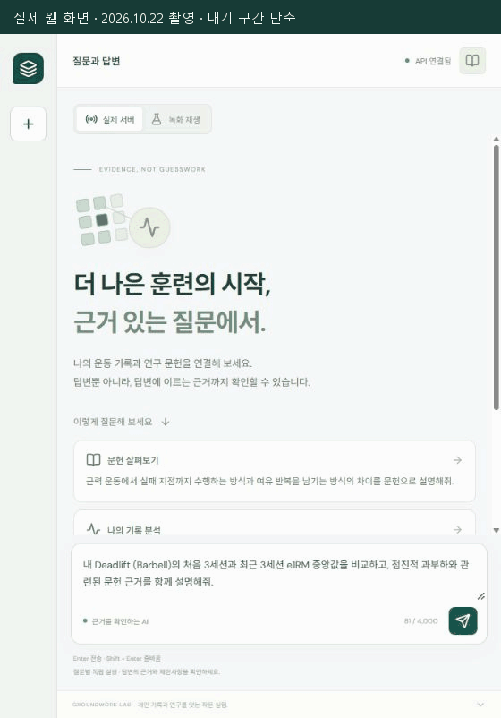
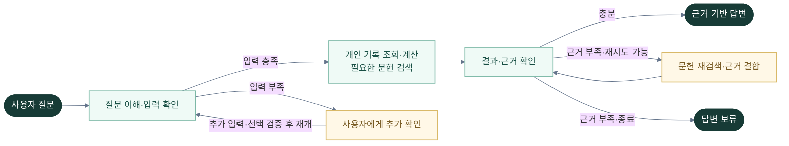

# Evidence-Grounded Agentic RAG

**개인 운동 기록의 변화와 운동과학 문헌의 근거를 함께 살펴보는 Agentic RAG 프로젝트입니다.**

공개된 장기 운동 기록을 개인 기록으로 가정하고, PostgreSQL에서 조회·계산한 결과와 운동과학 문헌을 함께 사용합니다. 기록에서 관찰한 변화와 일반 연구 결과를 구분해, 수치의 변화가 곧 개인의 생리학적 원인을 뜻하지 않도록 답변을 구성했습니다.

Tool 실행 순서, 입력 검증, 지표 계산, 재시도 상한과 종료 조건은 코드가 관리합니다. LLM은 실행 단계에 따라 질문 해석, 문헌 검색어 생성·번역, 근거 충분성 평가, 재검색 질의와 최종 답변 생성에 사용합니다. 구체적인 호출 조건은 아래에 설명했습니다.

**Python · FastAPI · LangGraph · Pydantic · PostgreSQL / pgvector · React / TypeScript**

[시스템 구조](docs/ARCHITECTURE.md) · [설치와 실행](docs/SETUP.md) · [평가와 한계](docs/EVALUATION.md) · [개발 이력](docs/HISTORY.md) · [프론트엔드](frontend/README.md)

## 실제 실행 화면

데드리프트의 처음 3세션과 최근 3세션 e1RM을 비교하고, 점진적 과부하와 관련된 문헌 근거를 함께 요청했습니다. 실제 웹 화면에서 질문을 전송하고, 답변과 실행 근거를 확인했습니다.



## 주요 기능

| 기능 | 동작 |
|---|---|
| 개인 기록 조회·계산 | 운동 기록을 조회하고 추정 1RM(e1RM), 세션별 요약, 주간 운동량·빈도, 운동 공백 등을 구현된 정의에 따라 계산합니다. |
| 운동과학 문헌 검색 | Dense와 BM25 검색 결과를 RRF로 결합하고, 질문에 필요한 문헌 근거를 확인합니다. |
| 기록과 문헌의 결합 | 개인 기록에서 관찰한 변화와 일반 연구 결과를 출처별로 구분해 설명합니다. |
| 추가 확인과 실행 재개 | 운동 후보가 여러 개이면 선택지를 제시하고, 검증된 선택을 기존 해석에 반영해 실행을 재개합니다. |
| 근거 부족 처리 | 부족한 문헌 근거를 대상으로 질의를 재작성하고 재검색합니다. 종료 조건에 도달하면 답변을 보류합니다. |
| 답변·근거 확인 화면 | React 화면에서 질문, 추가 확인, 답변, 사용 문헌과 실행 근거를 확인합니다. |

아래 구조와 사용 흐름은 **질문 해석·추가 확인 기능을 활성화한 구성**을 기준으로 설명합니다. 서버 기본값은 `legacy`이며, 이 구성은 `phase_a`와 개인 Metric 추출 설정을 명시적으로 선택해야 합니다. [설치 문서의 API 실행 절](docs/SETUP.md#api-실행)에 설정 방법을 안내했습니다.

## 전체 동작 흐름



질문에 필요한 Tool만 실행합니다. 문헌을 사용한 경우에만 Grader가 근거 충분성을 검사하며, 개인 기록만 사용하는 요청에는 이 검사를 적용하지 않습니다.

LangGraph는 이 흐름의 상태·분기·재시도·종료를 관리합니다. 각 구성요소의 역할과 세부 실행 경로는 [시스템 구조](docs/ARCHITECTURE.md)에 정리했습니다.

## 설계 원칙과 기술적 판단

- **계산 결과와 문헌 해석을 분리합니다.** e1RM 등 Metric은 코드로 계산하고, 일반 연구 결과를 개인의 변화 원인으로 단정하지 않습니다.
- **LLM 출력은 실행 전에 검증합니다.** Pydantic 계약, 실제 운동 목록, 검색 후보의 청크 ID를 확인합니다. 운동 후보가 여러 개면 사용자의 선택을 받아 기존 해석에 반영합니다.
- **평가 정답은 실행에 사용하지 않습니다.** Gold는 평가 단계에서만 읽으며, 동결한 데이터·평가셋·기존 기준선은 버전별로 보존합니다.

질문 해석·추가 확인 구성에서는 규칙으로 해석되지 않는 질문에만 LLM Interpreter를 호출합니다. 현재 검색 설정은 문헌 Tool의 첫 검색에서 검색어 생성과 영어 번역을 수행합니다. 생성·번역 실패 시에는 검증된 기존 문자열을 사용하는 보완 경로가 있습니다. 문헌 근거가 부족하고 재시도 조건을 충족하면 LLM이 Recovery 질의를 생성하고, 재검색 결과를 다시 평가합니다. 답변 가능한 상태에서는 LLM이 최종 답변을 작성하며, 추가 확인·보류·실패 응답에 이 답변 생성 단계를 일괄 적용하지 않습니다. [구현과 설정](docs/ARCHITECTURE.md#현재-서비스-검색과-근거-처리)

### 검색 순위 문제와 근거 누락을 분리했습니다

초기 진단에서 문헌 청크 488개 중 462개(94.67%)가 임베딩 모델의 128토큰 입력 한도를 넘었습니다. 별도로, 모든 BM25 점수가 0인 질문에서도 후보가 반환되어 RRF 순위에 기여하는 문제를 발견했습니다. 현재 서비스는 `positive_only`로 양수 점수 후보만 결합하지만, 기존 parent 청크와 128토큰 한도는 유지하므로 긴 청크 문제까지 해결한 것은 아닙니다.

별도 corpus v2 평가에서는 H0 대비 Final V2의 EGR@10이 0.188333에서 0.208333으로 높았지만, 필요한 근거를 모두 찾은 문항은 두 조건 모두 1/20이었습니다. 이는 BM25 변경만의 효과가 아니며, 현재 corpus v1 서비스의 성능 수치도 아닙니다. 현재 검색 설정의 사후 선택 과정과 함께 [검색 진단·평가](docs/EVALUATION.md#retrieval-v2-선택과-별도-평가)에 정리했습니다.

### 새 Grader를 만들었지만 채택하지 않았습니다

문헌 요구사항을 고정해 근거 충분성 판정의 일관성을 개선하려는 fixed-requirements Grader를 실험했습니다. 입력 경계를 보완한 v1.1의 Acceptance v2에서는 같은 질문 해석 모드에서 기존 Grader와 신규 Grader를 각각 21문항으로 비교했습니다. 최종 동작 정확도는 14/21에서 12/21로 낮아졌고, 답변 가능 문항의 보류와 답변 불가 문항의 답변이 각각 0건에서 1건으로 늘어 기존 Grader를 유지했습니다.

이 수치는 답변 문장 전체의 사실 정확도가 아닌 정해진 동작 계약의 일치율입니다. 일부 검색 결과도 달라 순수 Grader만의 인과 효과로 해석하지 않습니다. [비교 조건·채택 기준·원본 보고서](docs/EVALUATION.md#grader-v1v11-비채택과-acceptance-v2)

## 실행과 데모

**공개 저장소에는 코드와 검토된 문서를 제공합니다.** 원본 운동 기록, 문헌 원문, 동결 검색 산출물과 모델은 포함하지 않습니다. 저장소를 복제하는 것만으로 전체 질의 실행이나 과거 연구 평가를 재현할 수는 없습니다.

| 실행 범위 | 준비 사항 |
|---|---|
| API 문서·서버 상태 확인 | Python 의존성을 설치합니다. DB·OpenAI 연결은 필요하지 않습니다. |
| 공개 테스트 | Python 의존성을 설치합니다. 실제 DB·OpenAI 호출 없이 검증합니다. |
| 실제 질문·답변 | 운동 기록 DB, 문헌·검색 산출물, 모델, 서버 환경변수를 준비합니다. |
| React 화면 | Node.js 의존성을 설치합니다. 실제 질의에는 준비된 백엔드가 필요합니다. |

### 백엔드

Python 3.13을 공개 CI 기준으로 사용합니다. Windows PowerShell에서 다음과 같이 설치합니다.

```powershell
python -m venv .venv
.\.venv\Scripts\Activate.ps1
python -m pip install -r requirements-api.txt
```

실제 질문을 실행하려면 [데이터·DB 준비](docs/SETUP.md#데이터와-db-준비)를 완료하고, [API 실행 환경 설정](docs/SETUP.md#api-실행)의 질문 해석·개인 Metric 추출 설정을 서버를 실행할 터미널에 적용합니다. **아래 서버 명령만으로 질문 해석·추가 확인 기능이 활성화되지는 않습니다.** 설정 후 서버를 실행합니다.

```powershell
python -m uvicorn src.api.app:app --host 127.0.0.1 --port 8000
```

Swagger UI는 [http://127.0.0.1:8000/docs](http://127.0.0.1:8000/docs)에서 확인합니다. 실제 질의에는 `PGPASSWORD`, `OPENAI_API_KEY` 등 서버 환경 설정이 필요합니다. [환경변수 안내 파일](.env.example)은 자동으로 로드되지 않습니다.

| API | 역할 |
|---|---|
| `GET /health` | 서버 생존 상태를 확인합니다. DB·LLM 준비 완료를 보장하지 않습니다. |
| `GET /version` | 공개 가능한 실행 설정을 반환합니다. |
| `POST /query` | 자연어 질문을 처리합니다. |
| `POST /query/clarify` | 운동 후보 선택을 검증하고 실행을 재개합니다. |

질문 입력 형식은 다음과 같습니다. 처리 결과는 준비된 기록과 문헌 근거에 따라 달라집니다.

```json
{
  "question": "내 데드리프트의 처음 3세션과 최근 3세션의 e1RM 중앙값을 비교해줘."
}
```

응답에서는 `final_status`, `answer_text`, 사용한 Tool과 문헌 청크 ID, 한계를 함께 확인합니다. 추가 확인 요청은 현재 공개 계약상 `abstain_ready`와 `response_metadata`로 표현합니다. HTTP 200만으로 답변 성공을 판단하지 않습니다.

### 프론트엔드

React·TypeScript 기반 화면에서 질문·답변, 추가 확인 입력, 문헌과 실행 근거를 확인합니다. Node.js 22.12 이상에서 별도 터미널을 열고 실행합니다.

```powershell
cd frontend
npm ci
npm run dev
```

[http://127.0.0.1:5173/](http://127.0.0.1:5173/)에서 화면을 확인합니다. 실제 API 연결과 저장된 서버 응답 재생을 지원합니다. 프론트엔드 재생 목록에 포함된 JSON은 **실제 실행 결과가 아닌 형식 예시**이며 화면에서도 구분해 표시합니다. 실제 응답 녹화·재생 방법은 [프론트엔드 문서](frontend/README.md)에 정리했습니다.

## 검증과 한계

코드 동작 검증, 외부 서비스 연결 확인, 연구 성능 평가를 구분합니다.

| 검증 구분 | 확인하는 내용 |
|---|---|
| 단위·통합·공개 CI 테스트 | 통제된 응답과 합성 입력으로 입력 검증, 상태 전이, API 계약, 회귀 여부를 확인합니다. |
| 로컬 전체 테스트 | 공개 테스트에 더해 로컬 동결 산출물과 데이터 의존 검사를 수행합니다. |
| 실제 API 연결 확인 | 준비된 환경에서 DB·LLM·API 연결과 실행 결과를 확인합니다. 연구 성능과 구분합니다. |
| 연구 평가 | 고정된 조건에서 검색·근거 검증·최종 동작을 평가합니다. 버전과 평가 범위를 함께 기록합니다. |

공개 CI와 동일한 테스트는 저장소 루트에서 실행합니다.

```powershell
python -m pytest -m "not requires_local_artifacts" -q
```

로컬 연구 자료를 준비한 환경에서는 `python -m pytest -q`로 전체 테스트를 실행합니다. 프론트엔드는 `frontend` 디렉터리에서 `npm test`, `npm run lint`, `npm run build`로 검증합니다.

검색 방식, 질문 해석, Grader와 Recovery를 실험하고 채택·비채택 근거를 기록했습니다. 반복 분석한 평가셋의 결과를 독립적인 일반화 성능으로 표현하지 않으며, `answer_ready` 비율을 정확도로 사용하지 않습니다. 구체적인 결과와 조건은 [평가 문서](docs/EVALUATION.md), 변경 과정은 [개발 이력](docs/HISTORY.md)에서 확인합니다.

현재 주요 한계는 다음과 같습니다.

- 질문 해석과 문헌 근거 검증 과정에서 불필요한 추가 확인·답변 보류가 발생할 수 있습니다.
- 문헌에 필요한 근거가 없거나 검색에서 누락될 수 있으며, 재검색이 개선을 보장하지 않습니다.
- 개인 Metric 요청은 단일 Metric 중심으로 지원합니다. 임의의 복수 계산이나 운동 그룹 병합을 제공하지 않습니다.
- 최종 답변 전체의 과학적 정확성과 개인 조언의 적절성에 대한 독립적인 사람 평가는 수행하지 않았습니다.
- 인증, 요청 빈도 제한, 다중 사용자 데이터 격리를 제공하지 않는 로컬 데모입니다.

## 코드 구성

```text
src/api/             FastAPI 요청·응답을 처리합니다.
src/graph/           LangGraph 실행 흐름을 관리합니다.
src/interpretation/  질문을 해석하고 운동 후보를 검증합니다.
src/tools/           기록 조회·지표 계산·문헌 검색을 연결합니다.
src/metrics/         운동 지표를 계산합니다.
src/retrieval/       Dense·BM25·RRF 검색을 수행합니다.
src/grading/         문헌 근거의 충분성을 판정합니다.
src/recovery/        재검색 질의와 근거 결합을 처리합니다.
src/answer/          답변과 보류 응답을 생성합니다.
src/evaluation/      평가 계약과 지표를 관리합니다.
frontend/            질문·답변·근거 화면을 제공합니다.
tests/               기능·계약·회귀를 검증합니다.
docs/                구조·설치·평가·개발 이력을 안내합니다.
```

세부 책임과 현재 검색 설정은 [시스템 구조](docs/ARCHITECTURE.md), 자료 준비와 공개 범위는 [설치 문서](docs/SETUP.md), DB 적재 절차는 [DB 문서](db/README.md)에 정리했습니다.
