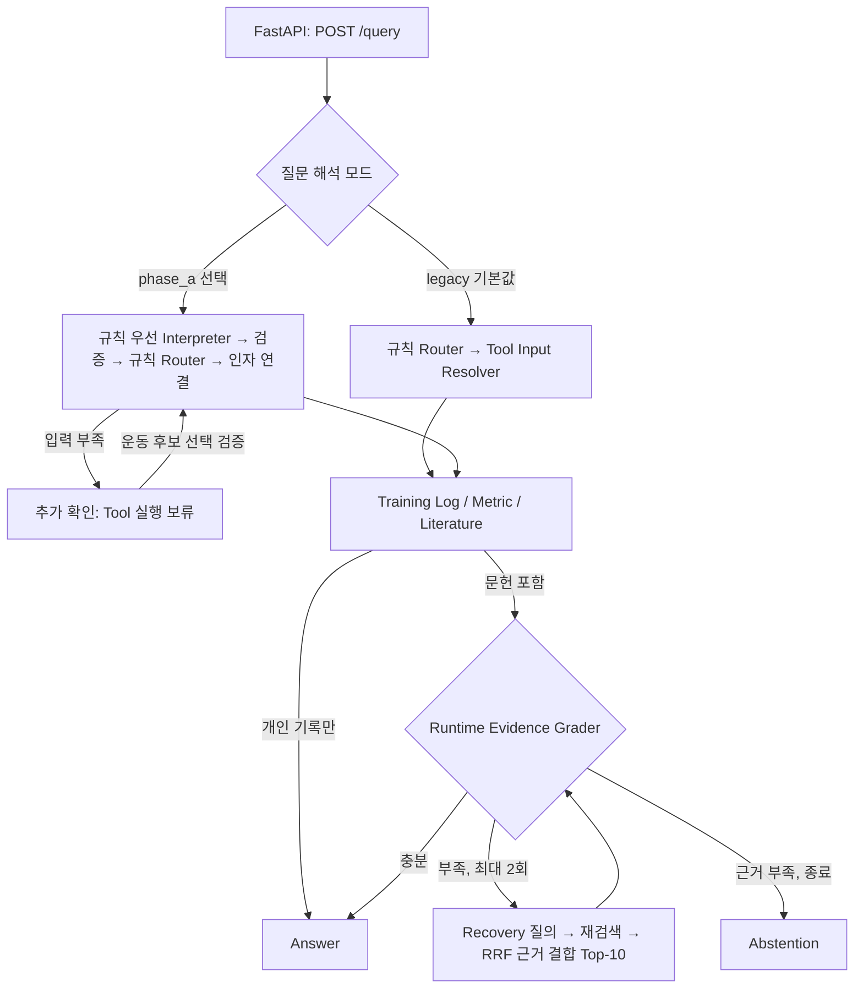

# 현재 시스템 구조

공개 장기 운동 기록을 사용자 기록으로 가정한 로컬 Agentic RAG 데모다. 개인 기록의 관찰과 일반 운동과학 문헌을 구분하며, 규칙 기반 실행 제어와 제한된 LLM 해석·판단을 결합한다. [설치](SETUP.md), [평가와 한계](EVALUATION.md), [개발 이력](HISTORY.md)을 함께 참고한다.

## 실행 흐름

LangGraph는 state·분기·반복·종료를 관리한다. 검색은 Literature Tool이, 판정은 Grader와 결정론적 finalizer가 수행한다. LLM은 Tool 실행 순서, canonical 운동명, 재시도 상한을 자유롭게 결정하지 않는다. Gold·정답·case label은 실행 경로에 들어가지 않는다.

## 코드 탐색

| 경로 | 책임 |
|---|---|
| [`src/api`](../src/api) | 공개 계약, 지연 초기화, `/health`, `/version`, `/query`, `/query/clarify` |
| [`src/graph`](../src/graph) | LangGraph state와 node, 인자 연결, 문헌 첫 검색 경계 |
| [`src/interpretation`](../src/interpretation), [`src/routing`](../src/routing) | 질문 해석·grounding·운동 후보 검증, 규칙 Router |
| [`src/agent`](../src/agent), [`src/tools`](../src/tools), [`src/metrics`](../src/metrics) | typed 실행 계획, Training Log·Metric·Literature, 계산 정의 |
| [`src/retrieval`](../src/retrieval) | Dense·BM25·RRF, pgvector, 첫 검색어 생성·번역 |
| [`src/grading`](../src/grading), [`src/recovery`](../src/recovery), [`src/answer`](../src/answer) | 근거 충분성, 제한된 재검색, 답변과 보류 |
| [`src/database`](../src/database), [`src/preprocessing`](../src/preprocessing), [`src/literature`](../src/literature), [`db`](../db) | DB 연결·적재, 기록 정규화, JATS 수집·corpus 구축 |
| [`src/evaluation`](../src/evaluation), [`src/smoke`](../src/smoke) | 실행 경로와 분리된 지표·검증 도구와 연결 확인 |
| [`config`](../config), [`scripts`](../scripts), [`tests`](../tests) | 버전별 설정·prompt, 준비·검증 진입점, 회귀 테스트 |
| [`frontend`](../frontend) | React·TypeScript 질문·추가 확인·근거 패널, 녹화 재생 |

`tests/test_runtime_import_boundary.py`는 API 실행 코드가 평가·데이터 준비 모듈을 import하지 않는지 검사한다. 과거 실험 이름이 남아 있어도 현재 검색 계약·데이터 준비·회귀 테스트가 공유하는 구현은 유지한다.

## 질문과 개인 기록

- 기본값 `legacy`: 규칙 Router가 Tool과 순서를 선택하고, Resolver가 선택된 Tool의 인자만 추출한다.
- `phase_a`: 명확한 단일 요청은 규칙으로 처리하고 부족할 때 typed LLM Interpreter를 한 번 호출한다. 실제 DB catalog membership, 원문 운동 표현·숫자·날짜·기간 및 operation 인자를 검증한 뒤 기존 workflow로 연결한다.
- Phase A 추출 버전은 기본 `original`과 명시적 `personal_metric_v1`을 유지한다. 후자는 일반 문헌의 결과변수를 별도의 개인 Metric 요청으로 잘못 추가하지 않도록 추출 규칙을 분리한 버전이다. 단일 Metric 지원 제한은 같다.
- 운동 후보가 여러 개면 확인 ID와 선택지를 반환한다. `/query/clarify`는 선택을 검증하고 기존 해석을 재사용한다. 승인 그룹의 공동 조회도 사용자 선택이 필요하다. 확인 state는 프로세스 메모리에 저장하며 20분 후 만료된다.
- 기간·N·비교 기준이 불명확하면 추측하지 않는다. 지원되는 최근 기간 정책과 operation별 필수 인자는 버전별 config가 기준이다. 처음/마지막 N세션 median e1RM은 `exercise_records`로 전체 운동 기록을 조회한 뒤 Metric에서 비교한다.
- Metric은 Epley e1RM, 세션 기반 요약, weekly volume·frequency, training gap, plateau candidate 등 구현된 정의만 계산한다. 관측된 e1RM 감소를 근육량 감소나 개인의 생리학적 원인으로 단정하지 않는다.

## 현재 서비스 검색과 근거 처리

서비스 구성 기본값은 [`retrieval_step3b_translation_v1.json`](../config/retrieval_step3b_translation_v1.json)이다. 운영 corpus는 **v1: 22편·488 chunks**이며, 별도 corpus v2 실험 설정과 구분한다. 하위 검색 라이브러리의 호환 기본값은 H0로 유지한다.

| 설정 | 서비스 값 |
|---|---|
| 첫 검색어 | 원 질문 → 문헌 검색어 생성 → 영어 번역, Dense와 BM25 공통 사용 |
| Encoder | `sentence-transformers/paraphrase-multilingual-MiniLM-L12-v2` |
| 고정 revision | `e8f8c211226b894fcb81acc59f3b34ba3efd5f42` |
| 입력 한도 / 차원 | 128 tokens / 384 |
| Dense | parent chunk, CPU, normalized float32, pgvector exact cosine |
| 후보 깊이 | Dense 10, BM25 10 |
| BM25 | positive_only, k1=1.2, b=0.75 |
| RRF / 최종 예산 | 동일 가중치 1:1, k=60 / Top-10 |

생성·번역 실패 시 검증된 기존 문자열을 사용하는 보완 경로가 있으며, Recovery에서 첫 검색어 생성·번역을 반복하지 않는다. Runtime Grader는 개인 Metric의 정확성이 아니라 문헌 근거 충분성을 판정한다. supporting chunk ID membership을 검증하고 finalizer가 최종 판정을 결정한다. 기존 Grader·Recovery·Answer prompt와 설정은 유지한다. optional 문헌도 실제 선택되면 기존 blocking 동작을 따른다.

`clarification_required`는 입력 부족, `abstain_ready`는 근거·지원 범위 부족, `execution_failure`는 실행 실패로 구분한다. 공개 API의 추가 확인 응답은 호환 계약에 따라 `abstain_ready`와 별도 metadata로 표현한다. graph의 세 종료 상태는 HTTP 200으로 반환하며, HTTP 성공만으로 답변 성공을 뜻하지 않는다.

## 경계와 제약

내부 trace·credential·provider 오류는 공개 응답에 노출하지 않는다. 개인 기록 결과와 문헌 근거는 별도 출처로 보존한다. 인증·rate limiting·사용자별 데이터 격리가 없는 로컬 데모이며, 복수 Metric 실행·임의 운동 그룹 병합·지원 밖 계산은 제공하지 않는다. 성능 평가와 실제 연결 검증의 범위는 [평가 문서](EVALUATION.md)에 구분한다.
